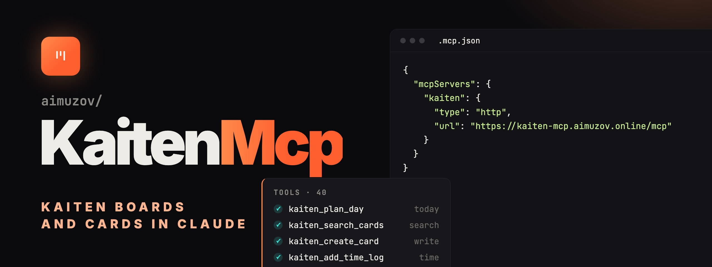

<p align="center">
	
	<a href="README.ru.md"></a>
</p>

<p align="center">
	
</p>

<p align="center">
	<a href="https://github.com/aimuzov/kaiten-mcp/actions/workflows/check.yml"></a>
	<a href="https://github.com/aimuzov/kaiten-mcp/releases"></a>
	<a href="package.json"></a>
	<a href="https://modelcontextprotocol.io"></a>
	<a href="LICENSE"></a>
</p>

<h3 align="center">Kaiten from any MCP client</h3>
<p align="center">40 tools for spaces, boards, cards, comments, checklists and time, local or as a hosted connector</p>

An MCP server for [Kaiten](https://kaiten.ru): spaces, boards, cards, comments, checklists, external links, time tracking and a day plan from Claude or any other MCP client. It runs locally over stdio or as a hosted connector, where everyone signs in with their own Kaiten token.

## Tools

40 tools, grouped by area:

- **Users**: `kaiten_get_current_user` (the owner of the token, to learn your user id), `kaiten_list_users` (filter by name or email).
- **Spaces and boards**: `kaiten_list_spaces`, `kaiten_get_space`, `kaiten_list_boards` (without `space_id` it takes `KAITEN_DEFAULT_SPACE_ID`), `kaiten_get_board`.
- **Lookups**: `kaiten_list_columns`, `kaiten_list_lanes`, `kaiten_list_card_types`, `kaiten_list_tags`.
- **Cards**: `kaiten_get_card`, `kaiten_create_card`, `kaiten_update_card` (only the changed fields), `kaiten_move_card` (column, lane or board), `kaiten_delete_card`, `kaiten_archive_card`.
- **Members and tags**: `kaiten_add_card_member`, `kaiten_remove_card_member`, `kaiten_add_card_tag` (by name, creates a missing tag), `kaiten_remove_card_tag`.
- **External links**: `kaiten_list_card_external_links`, `kaiten_add_card_external_link`, `kaiten_update_card_external_link`, `kaiten_remove_card_external_link`. A link to a merge request belongs here rather than in a comment.
- **Search**: `kaiten_search_cards`, full text and filters; rare API parameters go through `extra_params`.
- **Comments**: `kaiten_list_comments`, `kaiten_create_comment` (markdown), `kaiten_update_comment`, `kaiten_delete_comment`.
- **Checklists**: `kaiten_list_checklists`, `kaiten_add_checklist`, `kaiten_add_checklist_item`, `kaiten_update_checklist_item`, `kaiten_delete_checklist_item`.
- **Time tracking**: `kaiten_list_time_logs`, `kaiten_add_time_log` (minutes), `kaiten_delete_time_log`.
- **Planning**: `kaiten_today_tasks` (active cards due today or earlier, ASAP first), `kaiten_overdue_cards`, `kaiten_plan_day` (overdue and today as ready markdown plus a structured list). Without `user_id` they take the owner of the token.

## Hosted connector

In Claude: Settings → Connectors → Add custom connector → `https://kaiten-mcp.aimuzov.online/mcp`. In Claude Code:

```bash
claude mcp add --transport http kaiten https://kaiten-mcp.aimuzov.online/mcp
```

The browser opens a sign-in form for your Kaiten address and API token (Profile → API keys). The server checks the token against Kaiten and puts it inside an encrypted access token, so it is never stored on the server: `auth.db` keeps only the registered OAuth clients. An address typed into the form has to be a public https host, private and link-local addresses are refused.

## Local server

Node 26 or newer. See [.mcp.json.example](.mcp.json.example):

```json
{
	"mcpServers": {
		"kaiten": {
			"command": "npx",
			"args": ["-y", "@aimuzov/kaiten-mcp"],
			"env": { "KAITEN_API_URL": "https://your-domain.kaiten.ru", "KAITEN_API_TOKEN": "your-api-token" }
		}
	}
}
```

Without `KAITEN_API_URL` and `KAITEN_API_TOKEN` the server asks for them through elicitation on the first API call and keeps them in memory only. A client without elicitation gets an error with a hint to set the variables.

| Variable                         | Default | What it does                                                                       |
| -------------------------------- | ------- | ---------------------------------------------------------------------------------- |
| `KAITEN_API_URL`                 |         | Kaiten address, `/api/latest` may be omitted. In `--http` one address for everyone |
| `KAITEN_API_TOKEN`               |         | API token for stdio                                                                |
| `KAITEN_DEFAULT_SPACE_ID`        |         | Default space                                                                      |
| `KAITEN_REQUEST_TIMEOUT_MS`      | `30000` | Kaiten request timeout, 1000 to 600000                                             |
| `KAITEN_MAX_CONCURRENT_REQUESTS` | `5`     | Parallel requests per token, 1 to 20                                               |
| `KAITEN_LOG_LEVEL`               | `info`  | `error`, `warn`, `info` or `debug`                                                 |
| `KAITEN_LOG_FILE`                |         | A log file on top of stderr                                                        |

A typo in a number or the log level stops the start with the variable's name. `.env` in the working directory is read too, the environment wins.

## Running the connector

`kaiten-mcp serve --http` is the same server with OAuth 2.1, PKCE and dynamic client registration on [infra-mcp-kit](https://github.com/aimuzov/infra-mcp-kit). On top of the variables above it needs:

| Variable                | Default                | What it does                                                    |
| ----------------------- | ---------------------- | --------------------------------------------------------------- |
| `PUBLIC_URL`            |                        | Public address of the connector, required                       |
| `AUTH_SECRET`           |                        | Token key, 32 characters or more; changing it logs everyone out |
| `PORT`                  | `8080`                 |                                                                 |
| `KAITEN_MCP_DATA_DIR`   | `~/.config/kaiten-mcp` | Where `auth.db` lives                                           |
| `ALLOWED_REDIRECT_URIS` |                        | OAuth callbacks besides Claude and loopback                     |

It runs on the projects server in Docker behind the shared Caddy, see [deploy/](deploy) and [.env.example](.env.example). A release deploys itself.

## Development

```bash
npm ci
npm start          # stdio straight from the TypeScript sources
npm test           # node --test, the OAuth flow against a fake Kaiten included
npm run typecheck
npm run lint
npm run dev:pages  # the connector pages with Astro HMR
npm run test:ui    # the pages in Chromium: npx playwright install --with-deps chromium
```

## Kaiten API notes

- Base path `/api/latest`, `Authorization: Bearer <token>`.
- Column type: `1` queue, `2` in progress, `3` done. Card `condition`: `1` active, `2` archived.
- 5xx is retried only for `GET`, `PUT` and `DELETE`: a repeated `POST` could create a card or a time log twice. 429 and 503 with `Retry-After` are retried for any method, the pause follows the header, at most a minute.

## License

[MIT](LICENSE)
