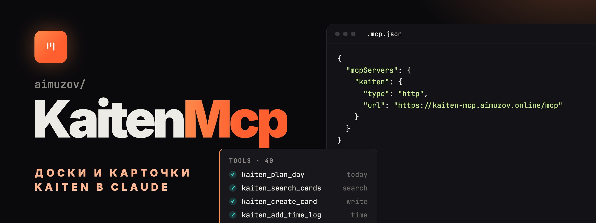

<p align="center">
	<a href="README.md"></a>
	
</p>

<p align="center">
	
</p>

<p align="center">
	<a href="https://github.com/aimuzov/kaiten-mcp/actions/workflows/check.yml"></a>
	<a href="https://github.com/aimuzov/kaiten-mcp/releases"></a>
	<a href="package.json"></a>
	<a href="https://modelcontextprotocol.io"></a>
	<a href="LICENSE"></a>
</p>

<h3 align="center">Kaiten из любого MCP-клиента</h3>
<p align="center">40 инструментов для пространств, досок, карточек, комментариев, чек-листов и времени, локально или как коннектор</p>

MCP-сервер для [Kaiten](https://kaiten.ru): пространства, доски, карточки, комментарии, чек-листы, внешние ссылки, учёт времени и план на день из Claude или любого другого MCP-клиента. Работает локально по stdio или как размещённый коннектор, куда каждый входит своим токеном Kaiten.

## Инструменты

40 инструментов по областям:

- **Пользователи**: `kaiten_get_current_user` (владелец токена, чтобы узнать свой id), `kaiten_list_users` (фильтр по имени или email).
- **Пространства и доски**: `kaiten_list_spaces`, `kaiten_get_space`, `kaiten_list_boards` (без `space_id` берёт `KAITEN_DEFAULT_SPACE_ID`), `kaiten_get_board`.
- **Справочники**: `kaiten_list_columns`, `kaiten_list_lanes`, `kaiten_list_card_types`, `kaiten_list_tags`.
- **Карточки**: `kaiten_get_card`, `kaiten_create_card`, `kaiten_update_card` (только изменённые поля), `kaiten_move_card` (колонка, дорожка или доска), `kaiten_delete_card`, `kaiten_archive_card`.
- **Участники и теги**: `kaiten_add_card_member`, `kaiten_remove_card_member`, `kaiten_add_card_tag` (по имени, создаёт недостающий тег), `kaiten_remove_card_tag`.
- **Внешние ссылки**: `kaiten_list_card_external_links`, `kaiten_add_card_external_link`, `kaiten_update_card_external_link`, `kaiten_remove_card_external_link`. Ссылке на merge request место здесь, а не в комментарии.
- **Поиск**: `kaiten_search_cards`, полнотекстовый и с фильтрами; редкие параметры API передаются через `extra_params`.
- **Комментарии**: `kaiten_list_comments`, `kaiten_create_comment` (markdown), `kaiten_update_comment`, `kaiten_delete_comment`.
- **Чек-листы**: `kaiten_list_checklists`, `kaiten_add_checklist`, `kaiten_add_checklist_item`, `kaiten_update_checklist_item`, `kaiten_delete_checklist_item`.
- **Учёт времени**: `kaiten_list_time_logs`, `kaiten_add_time_log` (в минутах), `kaiten_delete_time_log`.
- **Планирование**: `kaiten_today_tasks` (активные карточки со сроком сегодня или раньше, сначала ASAP), `kaiten_overdue_cards`, `kaiten_plan_day` (просроченное и сегодняшнее готовым markdown плюс структурированный список). Без `user_id` берут владельца токена.

## Размещённый коннектор

В Claude: Settings → Connectors → Add custom connector → `https://kaiten-mcp.aimuzov.online/mcp`. В Claude Code:

```bash
claude mcp add --transport http kaiten https://kaiten-mcp.aimuzov.online/mcp
```

В браузере откроется форма входа: адрес Kaiten и API-токен (Профиль → API-ключи → Создать). Сервер проверяет токен в Kaiten и кладёт его внутрь зашифрованного токена доступа, поэтому на сервере он не хранится: в `auth.db` лежат только зарегистрированные OAuth-клиенты. Адрес из формы должен быть публичным https-хостом, приватные и link-local адреса отклоняются.

## Локальный сервер

Нужен Node 26 или новее. См. [.mcp.json.example](.mcp.json.example):

```json
{
	"mcpServers": {
		"kaiten": {
			"command": "npx",
			"args": ["-y", "@aimuzov/kaiten-mcp"],
			"env": { "KAITEN_API_URL": "https://your-domain.kaiten.ru", "KAITEN_API_TOKEN": "your-api-token" }
		}
	}
}
```

Без `KAITEN_API_URL` и `KAITEN_API_TOKEN` сервер спросит их через elicitation при первом запросе к API и будет держать только в памяти. Клиент без elicitation получит ошибку с подсказкой задать переменные.

| Переменная                       | По умолчанию | Что делает                                                                 |
| -------------------------------- | ------------ | -------------------------------------------------------------------------- |
| `KAITEN_API_URL`                 |              | Адрес Kaiten, `/api/latest` можно не писать. В `--http` один адрес на всех |
| `KAITEN_API_TOKEN`               |              | API-токен для stdio                                                        |
| `KAITEN_DEFAULT_SPACE_ID`        |              | Пространство по умолчанию                                                  |
| `KAITEN_REQUEST_TIMEOUT_MS`      | `30000`      | Таймаут запроса к Kaiten, от 1000 до 600000                                |
| `KAITEN_MAX_CONCURRENT_REQUESTS` | `5`          | Одновременных запросов на токен, от 1 до 20                                |
| `KAITEN_LOG_LEVEL`               | `info`       | `error`, `warn`, `info` или `debug`                                        |
| `KAITEN_LOG_FILE`                |              | Файл лога сверх stderr                                                     |

Опечатка в числе или уровне лога останавливает запуск с именем переменной. `.env` в рабочем каталоге тоже читается, окружение главнее.

## Запуск коннектора

`kaiten-mcp serve --http` — тот же сервер с OAuth 2.1, PKCE и динамической регистрацией клиентов на [infra-mcp-kit](https://github.com/aimuzov/infra-mcp-kit). Сверх переменных выше ему нужны:

| Переменная              | По умолчанию           | Что делает                                                |
| ----------------------- | ---------------------- | --------------------------------------------------------- |
| `PUBLIC_URL`            |                        | Публичный адрес коннектора, обязателен                    |
| `AUTH_SECRET`           |                        | Ключ токенов от 32 символов; его смена разлогинивает всех |
| `PORT`                  | `8080`                 |                                                           |
| `KAITEN_MCP_DATA_DIR`   | `~/.config/kaiten-mcp` | Где лежит `auth.db`                                       |
| `ALLOWED_REDIRECT_URIS` |                        | OAuth-колбэки сверх Claude и loopback                     |

Работает на сервере проектов в Docker за общим Caddy, см. [deploy/](deploy) и [.env.example](.env.example). Релиз выкатывается сам.

## Разработка

```bash
npm ci
npm start          # stdio прямо из исходников TypeScript
npm test           # node --test, вместе с OAuth-потоком против поддельного Kaiten
npm run typecheck
npm run lint
npm run dev:pages  # страницы коннектора с HMR Astro
npm run test:ui    # страницы в Chromium: npx playwright install --with-deps chromium
```

## Заметки о Kaiten API

- Базовый путь `/api/latest`, `Authorization: Bearer <token>`.
- Тип колонки: `1` очередь, `2` в работе, `3` готово. `condition` карточки: `1` активна, `2` в архиве.
- 5xx повторяется только для `GET`, `PUT` и `DELETE`: повтор `POST` мог бы создать карточку или запись времени дважды. 429 и 503 с `Retry-After` повторяются для любого метода, пауза берётся из заголовка, но не дольше минуты.

## Лицензия

[MIT](LICENSE)
